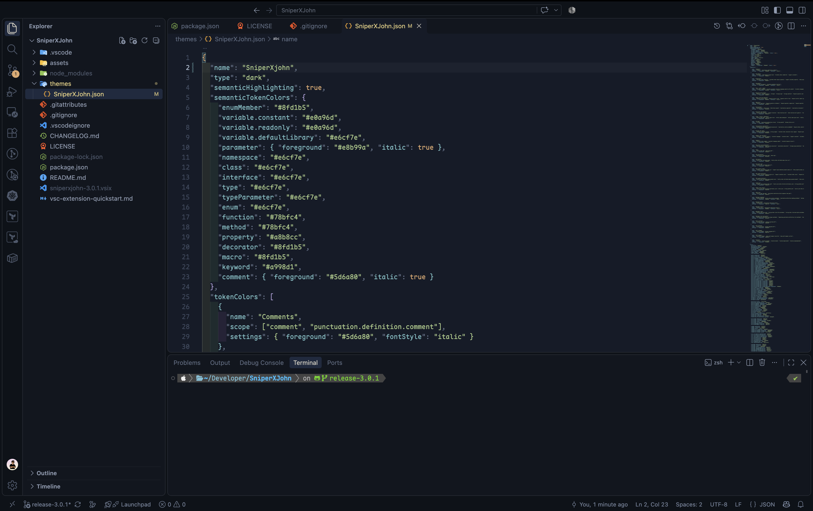

<div align="center">

# Softnight

**A VS Code colour theme tuned for long sessions and comfortable eyes.**

[](https://marketplace.visualstudio.com/items?itemName=asabhi6776.sniperxjohn)  [](LICENSE)



</div>

## Why this theme?

I built SniperXJohn for my own daily use, with colours that are easy on the eyes
over long coding sessions. It is shared as-is and updated occasionally.

## Installation

1. Open VS Code and go to Extensions (`Ctrl+Shift+X`).
2. Search for **SniperXJohn** and click **Install**.
3. Open the theme picker with `Ctrl+K Ctrl+T` (`Cmd+K Cmd+T` on macOS) and select **SniperXJohn**.

Or from the command line:

```bash
code --install-extension asabhi6776.sniperxjohn
```

## Recommended settings

```jsonc
{
  "editor.semanticHighlighting.enabled": true,
  "editor.bracketPairColorization.enabled": true
}
```

<!-- ## Language previews

<p align="center">
  
  
</p> -->

## Customising

To tweak individual colours without forking, override them in `settings.json`:

```jsonc
{
  "workbench.colorCustomizations": {
    "[SniperXJohn]": { "editor.background": "#101010" }
  },
  "editor.tokenColorCustomizations": {
    "[SniperXJohn]": { "comments": "#6a737d" }
  }
}
```

## Feedback and contributions

Found a hard-to-read colour? [Open an issue](https://github.com/abhixops/sniperxjohn/issues)
with a screenshot and the file type. PRs against `themes/SniperXJohn.json` are welcome.

## Changelog

See [CHANGELOG.md](CHANGELOG.md).

## License

MIT <!-- confirm this matches your LICENSE file -->